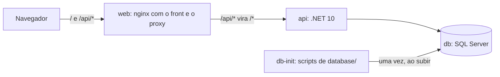

# Plano de implementação: Gestão de Pedidos (B-MO)

Versão 1.0 · 13/11/2026 · baseado na [spec](spec.md) v1.1, já com os critérios CA-40 e CA-41

Este documento descreve **como** construir o que a [spec](spec.md) pede. Ele não repete as regras: cita os códigos (`RN-xx`, `CA-xx`) e explica cada escolha de implementação. Se este plano e a spec discordarem, a spec vence e o plano é corrigido.

---

## 1. Visão geral



O navegador fala só com o contêiner `web`, que entrega o front e repassa `/api/*` para a API. Como front e API ficam na mesma origem, não há CORS para configurar, e o endereço da API não precisa ser embutido no build do front.

**Princípios**

- **As regras são funções puras.** A validação do pedido e a conversão de datas não conhecem banco nem HTTP, e são testadas sem nenhum dos dois.
- **O banco é a última barreira.** Chaves, `UNIQUE` e `CHECK` garantem o essencial mesmo que o código erre.
- **UTC por dentro, São Paulo na borda** (RN-12). Só a interpretação dos filtros e a exibição conhecem o fuso.
- **SQL à vista.** As consultas que importam estão escritas por extenso no código, e cada índice existe por causa de uma delas.

### Decisões principais

| Decisão | Alternativa descartada | Por quê |
|---|---|---|
| **Dapper, com SQL escrito à mão** | EF Core | O esquema já mora nos scripts de `database/` (spec, seção 9). Com o EF Core, ele seria descrito de novo no código e poderia divergir. Além disso, as três consultas críticas (baixa de estoque, listagem e relatório) ficam legíveis, e é fácil conferir que usam os índices da seção 3.3. |
| **Minimal APIs, agrupadas por funcionalidade** | Controllers | São sete endpoints. Cada arquivo de rotas cabe numa tela e mostra, juntos, a entrada e as respostas possíveis. |
| **Validação escrita à mão** | DataAnnotations, FluentValidation | A spec separa 400 (forma da requisição) de 422 (regra de negócio). Um `[Range]` em `quantidade` transformaria a RN-03 em 400 por engano. A validação explícita deixa essa fronteira visível e é testável sem HTTP. |
| **Regras num projeto sem dependências (`BMO.Dominio`)** | Um projeto só; Clean Architecture em quatro projetos | O compilador garante que as regras não dependem de banco nem de HTTP, e os testes unitários dispensam mocks. Mais camadas que isso seriam cerimônia para quatro tabelas. |
| **Banco preparado por um contêiner de inicialização** | Migrações rodando na subida da API | A API não administra esquema, e o mesmo script prepara o banco no Compose e nos testes de integração. |
| **Testcontainers nos testes de integração** | Banco compartilhado, LocalDB | A spec exige SQL Server real. Cada execução ganha um banco limpo e descartável, igual em qualquer máquina e no CI. |
| **TanStack Query no front** | `useEffect` com `fetch` | Cache, cancelamento de requisições antigas e recarga da lista depois de criar um pedido vêm prontos. |

---

## 2. Estrutura do repositório

```text
.
├── .github/workflows/ci.yml       build, testes e E2E a cada push e pull request
├── .gitattributes                 força fim de linha LF nos scripts .sh (ver 7.1)
├── docker-compose.yml             db, db-init, api, web
├── .env.example                   variáveis opcionais (o Compose funciona sem .env)
├── database/
│   ├── inicializar.sh             espera o SQL Server e roda esquema/ e, se pedido, carga/
│   ├── esquema/                   banco, tabelas, índices e login da API
│   └── carga/                     dados de exemplo
├── backend/
│   ├── BMO.slnx
│   ├── Dockerfile
│   ├── src/
│   │   ├── BMO.Dominio/           regras puras: validação do pedido, período e fuso, filtros
│   │   └── BMO.Api/               endpoints, SQL, erros, JSON, saúde
│   └── tests/
│       ├── BMO.Testes.Unitarios/      referencia só o BMO.Dominio
│       └── BMO.Testes.Integracao/     API inteira contra SQL Server em contêiner
├── frontend/
│   ├── Dockerfile                 build do Vite e nginx (estáticos e proxy /api)
│   ├── nginx.conf
│   └── src/
│       ├── api/                   cliente HTTP e tipos do contrato (seção 6 da spec)
│       ├── pedidos/               lista de pedidos e modal de novo pedido
│       ├── components/ui/         componentes do shadcn/ui, gerados pela CLI
│       └── lib/                   formatação de data (São Paulo) e de dinheiro
├── e2e/                           Playwright, num projeto Node próprio
└── docs/
    ├── spec.md
    ├── plan.md
    └── fluxos/
```

`components/ui/` fica em inglês porque é o caminho padrão da CLI do shadcn/ui. O código escrito para o projeto fica em pastas com nomes em português.

---

## 3. Banco de dados

### 3.1 Scripts e inicialização

- Os scripts ficam em `database/esquema/` (estrutura) e `database/carga/` (dados de exemplo), numerados (`001_...sql`) e executados em ordem.
- Todos são **idempotentes**: objetos são criados com `IF NOT EXISTS`, e a carga só roda com o banco vazio. Subir o ambiente de novo não duplica nada nem dá erro.
- `database/inicializar.sh` espera o SQL Server responder e roda os scripts com `sqlcmd -b`, que para no primeiro erro. O mesmo script é usado em dois lugares:
  - no Compose, pelo contêiner `db-init`, que roda uma vez e termina. A API só sobe depois que ele termina com sucesso;
  - nos testes de integração, dentro do contêiner do Testcontainers, rodando só `esquema/`, porque cada teste cria os próprios dados.
- O banco é criado com a collation `Latin1_General_100_CI_AI`, em que toda comparação de texto ignora maiúsculas, minúsculas e acentos. É o que a RN-15 pede ("joao" encontra "João"). A collation padrão da imagem do SQL Server (`SQL_Latin1_General_CP1_CI_AS`) diferencia acentos e quebraria o CA-19.
- A API conecta com um login próprio (`bmo_api`), que só tem permissão para ler e gravar dados. O `sa` fica restrito aos scripts.

### 3.2 Tabelas

A spec (seção 4) define colunas e tipos. O plano acrescenta o que o banco precisa garantir sozinho, mesmo que o código erre:

| Tabela | Restrição | Garante |
|---|---|---|
| Clientes | `UNIQUE (Email)` | E-mail único. Com a collation do banco, a comparação também ignora maiúsculas |
| Clientes | `DEFAULT SYSUTCDATETIME()` em `DataCadastro` | Data de cadastro em UTC |
| Produtos | `CHECK (Preco > 0)` | Preço positivo |
| Produtos | `CHECK (Estoque >= 0)` | **Última barreira da RN-10.** Se um bug furar a baixa condicional, o banco recusa o estoque negativo |
| ItensPedido | `PRIMARY KEY (PedidoId, ProdutoId)` | RN-04 garantida pelo próprio banco (spec, seção 4) |
| ItensPedido | `CHECK (Quantidade > 0)` e `CHECK (PrecoUnitario > 0)` | RN-03 e preço copiado válido |
| Pedidos, ItensPedido | Chaves estrangeiras para `Clientes`, `Pedidos` e `Produtos` | Nenhum pedido ou item órfão |

`DataPedido` não tem valor padrão no banco. Quem define o valor é a API, com o relógio injetável (`TimeProvider`), para que os testes controlem o horário (RN-09). A coluna usa `datetime2` com a precisão padrão (7), a mesma do `DateTime` do .NET. Com menos precisão, o SQL Server **arredonda** o valor, e um pedido feito às 23:59:59,9 poderia ser gravado no dia seguinte.

### 3.3 Índices

| Índice | Colunas | Atende | Por quê |
|---|---|---|---|
| `PK_Clientes` (clustered) | `Id` | Cliente por número | Padrão |
| `UQ_Clientes_Email` | `Email` | Regra do e-mail único | A unicidade fica garantida no banco, não só no código |
| `IX_Clientes_Nome` | `Nome`, incluindo `Email` | `GET /clientes` (ordem alfabética, até 50) | O banco lê os clientes já em ordem de nome e para no 50º que casar com a busca, sem ordenar a tabela inteira |
| `PK_Produtos` (clustered) | `Id` | Baixa de estoque | A baixa localiza o produto pela chave e bloqueia **só aquela linha**. Pedidos de outros produtos não esperam |
| `PK_Pedidos` (clustered) | `Id` | `GET /pedidos/{id}` e busca pelo número (RN-15) | Padrão |
| `IX_Pedidos_DataPedido` | `DataPedido, Id`, incluindo `ClienteId` | Lista sem filtro, filtro de período e relatório de top clientes | Lida de trás para frente, a chave tem exatamente a ordem da RN-18 (`DataPedido DESC, Id DESC`). A lista sem filtro lê só as linhas da página, e um período vira um trecho contínuo do índice. Com `ClienteId` incluído, o relatório agrupa sem voltar à tabela |
| `IX_Pedidos_ClienteId_DataPedido` | `ClienteId, DataPedido, Id` | Filtro por cliente (RN-16), busca por texto e chave estrangeira | Os pedidos de um cliente ficam juntos e já na ordem da listagem |
| `PK_ItensPedido` (clustered) | `PedidoId, ProdutoId` | Soma dos itens de um pedido; RN-04 | Definido na spec: os itens de um pedido ficam fisicamente juntos |

**Não há índice em `ItensPedido.ProdutoId`.** Nenhuma consulta parte do produto para chegar aos itens, e produtos nunca são excluídos, então a verificação da chave estrangeira não precisa dele. O índice só deixaria a gravação mais lenta.

A busca por trecho (`LIKE '%texto%'`) não consegue usar índice para localizar o texto e lê a tabela `Clientes` inteira. É uma tabela pequena, e, depois de achar os clientes, o banco chega aos pedidos pelo `IX_Pedidos_ClienteId_DataPedido`. A busca de texto completo (full-text search) resolveria volumes maiores, mas não vem na imagem padrão do SQL Server para Linux e não se justifica aqui.

### 3.4 Carga de exemplo

A carga serve de demonstração e de cenário para os testes ponta a ponta. Ela é **determinística** (datas fixas, sem `RAND()` nem `NEWID()`), para que os mesmos dados apareçam em qualquer máquina. Ela inclui:

- cerca de 30 clientes, com **dois clientes de mesmo nome** e e-mails diferentes (RN-16, CA-22) e um "João Eventos", com acento (CA-19);
- cerca de 15 produtos, com os da spec ("Kit coffee break" a R$ 99,90 e "Crachá personalizado" a R$ 49,90), um **sem estoque** e um com **estoque baixo**, usado no CA-38;
- cerca de 150 pedidos entre 2025 e 2026 (mais de sete páginas de 20), com alguns itens cobrados a um preço diferente do atual (RN-08);
- pedidos **nas bordas do ano no horário de São Paulo**: 31/12/2025 às 23:59:59 (`2026-01-01T02:59:59Z`) e 01/01/2026 às 00:00:00 (`2026-01-01T03:00:00Z`), para mostrar a RN-13 nos relatórios de 2025 e de 2026.

Todos os pedidos da carga são anteriores a 01/11/2026, para que um pedido criado na hora apareça no topo da lista (CA-35).

---

## 4. Backend

### 4.1 Projetos

| Projeto | Contém | Depende de |
|---|---|---|
| `BMO.Dominio` | Validação do pedido (RN-01 a RN-11); conversão de período e fuso (RN-12 a RN-14); validação de filtros e de paginação (RN-14, RN-19, RN-20); cálculo de subtotal e de valor total | Nada |
| `BMO.Api` | Endpoints, SQL (Dapper), tratamento de erros, configuração de JSON, verificação de saúde | `BMO.Dominio`, Dapper, Microsoft.Data.SqlClient |

Dentro do `BMO.Api`, as pastas seguem as funcionalidades (`Pedidos/`, `Relatorios/`, `Clientes/`, `Produtos/`), e a infraestrutura comum fica em `Infraestrutura/`. Cada funcionalidade tem um arquivo de endpoints, que define as rotas e traduz o resultado para HTTP, e um repositório, que guarda todo o SQL dela. A criação de pedido tem também um serviço, que orquestra a validação e a gravação. As consultas vão direto do endpoint ao repositório, porque não têm regra além dos filtros, que o domínio já validou.

Todos os projetos têm `Nullable` habilitado e tratam avisos como erro, configurados uma vez no `Directory.Build.props`.

### 4.2 Criação de pedido (`POST /pedidos`)

A criação acontece em duas fases. A primeira encontra **todos** os problemas, para devolvê-los juntos (RN-11). A segunda grava com segurança, mesmo que outro pedido esteja disputando o mesmo estoque (RN-10).

**Fase 1: validação, sem transação**

1. **Forma da requisição → 400.** São casos de 400: `clienteId` ausente, `itens` ausente, item sem `produtoId` ou sem `quantidade`, ou JSON ilegível. Os campos chegam como anuláveis no DTO e a presença deles é verificada à mão, para que todo 400 de campo tenha o formato `errors` por campo. Lista vazia (`"itens": []`) não é erro de forma: é a RN-02, que vira 422.
2. O serviço faz duas consultas: se o cliente existe e quais dos produtos citados existem, com preço, nome e estoque.
3. O `ValidadorDePedido`, uma função pura do domínio, recebe a requisição e esses dados e devolve o pedido válido ou a lista de erros:
   - cliente inexistente → só `CLIENTE_NAO_ENCONTRADO`; pedido sem itens → só `PEDIDO_SEM_ITENS` (RN-11). Se os dois acontecerem, vale o primeiro, na ordem da spec;
   - fora desses casos, **um erro por produto**, na ordem em que o produto aparece na requisição. Linhas repetidas de um mesmo produto recebem um único `PRODUTO_DUPLICADO`. Para cada produto, vale a primeira regra violada desta tabela:

| Ordem | Código | Por que nesta posição |
|---|---|---|
| 1 | `PRODUTO_DUPLICADO` | É a única regra que envolve mais de uma linha. Com o produto repetido, as outras verificações seriam ambíguas (qual das quantidades conferir?) |
| 2 | `QUANTIDADE_INVALIDA` | Não depende do banco |
| 3 | `PRODUTO_NAO_ENCONTRADO` | Sem produto, não há estoque para conferir |
| 4 | `ESTOQUE_INSUFICIENTE` | Usa o estoque lido no passo 2 |

O estoque lido nesta fase serve **só para montar a lista completa de erros**. Um instante depois, ele já pode estar desatualizado. Quem garante o estoque é a fase 2.

**Fase 2: gravação, numa transação**

1. Abre a transação, com o isolamento padrão (`READ COMMITTED`).
2. Para cada item, **em ordem crescente de `ProdutoId`**, faz a baixa condicional e lê o preço da mesma linha:

   ```sql
   UPDATE Produtos
   SET Estoque = Estoque - @Quantidade
   OUTPUT inserted.Preco
   WHERE Id = @ProdutoId AND Estoque >= @Quantidade;
   ```

   - Se nenhuma linha voltar, o estoque não bastava. O item entra na lista de falhas, e a baixa continua nos itens seguintes, para que todas as falhas voltem juntas.
   - O `UPDATE` bloqueia a linha do produto até o fim da transação. Um segundo pedido pela mesma unidade espera, reavalia `Estoque >= @Quantidade` com o valor já baixado e não encontra a linha (RN-10, CA-11).
   - Com a baixa sempre em ordem crescente de `ProdutoId`, duas transações nunca bloqueiam os mesmos produtos em ordens cruzadas, que é o que causaria um deadlock.
   - O preço vem do `OUTPUT`, lido na linha já bloqueada. É exatamente o preço no momento da criação (RN-08).
3. Se houve falha: `ROLLBACK`, nova leitura do estoque dos produtos que falharam e resposta 422 com `ESTOQUE_INSUFICIENTE` e o `disponivel` atualizado. Nada foi gravado (RN-07).
4. Se não houve: grava o pedido com a `DataPedido` do `TimeProvider`, em UTC (RN-09), grava os itens com o preço do passo 2 e faz o `COMMIT`.
5. A resposta `201`, com `Location: /pedidos/{id}`, é montada pela mesma consulta do `GET /pedidos/{id}`. Assim, os dois endpoints devolvem exatamente o mesmo formato.

A gravação não é repetida automaticamente. Se a conexão cair depois do `COMMIT`, uma repetição criaria um segundo pedido (ver seção 10).

### 4.3 Datas e fuso horário

- **Por dentro, tudo é UTC.** O banco grava UTC, o código trabalha com `DateTime` em UTC e o JSON sai em UTC (seção 4.5). O horário de São Paulo só aparece ao **interpretar filtros**, descrito aqui, e ao **exibir**, no front (seção 5.4).
- O fuso é carregado uma vez, na inicialização, com `TimeZoneInfo.FindSystemTimeZoneById("America/Sao_Paulo")`. Se o sistema não tiver a base de fusos, a API falha ao subir, e não no meio de uma consulta. A imagem padrão `mcr.microsoft.com/dotnet/aspnet:10.0` já traz essa base (`tzdata`); entre as variantes *chiseled*, só as `-extra` a trazem.
- Um período de dias vira um intervalo semiaberto em UTC: do início de `dataInicio` até o início do dia seguinte a `dataFim`, sem incluir este último instante. A consulta usa `DataPedido >= @InicioUtc AND DataPedido < @FimUtc`. O limite exclusivo dispensa o "23:59:59.999" e não perde nenhum instante (RN-13, CA-14, CA-15).
- O início de um dia é a meia-noite em São Paulo convertida para UTC. Nos anos em que o horário de verão começava à meia-noite, esse horário não existia: o relógio pulava de 23:59:59 direto para 01:00. Nesses dias, o início é o primeiro instante válido; por exemplo, 04/11/2018 começa em `2018-11-04T03:00:00Z`. Sem esse cuidado, o `TimeZoneInfo` lança exceção, e um filtro com uma data dessas daria erro 500.
- `dataInicio` posterior a `dataFim` → 400 (RN-14, CA-16), verificado no domínio antes de qualquer consulta.

### 4.4 Consultas

**`GET /pedidos`**

- Os filtros entram num objeto do domínio (`FiltroPedidos`), que valida a página (mínimo 1), o tamanho (de 1 a 100) e o período (RN-14, RN-19) e devolve os erros por campo para o 400. Os parâmetros chegam como anuláveis, para que a falta de um obrigatório também caia nesse formato.
- O SQL é montado só com trechos fixos, um por filtro informado, e os valores entram sempre como parâmetros. Um filtro ausente não entra no `WHERE`, e o banco faz um plano adequado para cada combinação.
- **Busca (RN-15).** O texto passa por `Trim`, e um texto vazio equivale a não filtrar. Os curingas do `LIKE` (`%`, `_` e `[`) são escapados, para que "50%" procure o texto literal. A condição é: o cliente tem `Nome` ou `Email` contendo o texto **ou**, se o texto tiver só dígitos e couber num `int`, o pedido tem esse número. Acentos e maiúsculas são resolvidos pela collation do banco (seção 3.1), sem `LOWER()` nem remoção de acentos no código.
- **Ordenação e paginação (RN-18, RN-19).** `ORDER BY DataPedido DESC, Id DESC`, com `OFFSET` e `FETCH`. A consulta primeiro escolhe os pedidos da página e só depois soma os itens deles, então `quantidadeItens` e `valorTotal` custam o cálculo de uma página, não da tabela.
- A contagem total (`totalItens`) usa os mesmos filtros e vai na mesma ida ao banco (`QueryMultiple`). `totalPaginas` é `totalItens / tamanhoPagina` arredondado para cima, ou zero quando não há resultados. Uma página além da última devolve a lista vazia, com os totais corretos.

**`GET /pedidos/{id}`.** Pedido, cliente e itens vêm numa ida ao banco, e os subtotais e o valor total são calculados no domínio a partir dos itens. Pedido inexistente → 404. A rota usa `{id:int}`, então um número inválido também dá 404.

**`GET /relatorios/top-clientes` (RN-20)**

```sql
WITH Totais AS (
  SELECT p.ClienteId,
         COUNT(DISTINCT p.Id) AS TotalPedidos,
         SUM(i.Quantidade * i.PrecoUnitario) AS ValorTotal
  FROM Pedidos p
  JOIN ItensPedido i ON i.PedidoId = p.Id
  WHERE p.DataPedido >= @InicioUtc AND p.DataPedido < @FimUtc
  GROUP BY p.ClienteId
)
SELECT TOP (@Limite) t.ClienteId, c.Nome, c.Email, t.TotalPedidos, t.ValorTotal
FROM Totais t
JOIN Clientes c ON c.Id = t.ClienteId
ORDER BY t.ValorTotal DESC, t.ClienteId ASC;
```

O agrupamento é por `ClienteId`, e o nome só entra depois, na junção. Dois clientes de mesmo nome nunca se misturam (CA-31). `posicao` é a ordem da linha no resultado (1, 2, 3...). `limite` fora de 1 a 20 e período ausente → 400 (CA-30, CA-34).

**Endpoints de apoio.** `GET /clientes?busca=` usa a mesma busca por nome e e-mail, ordena por `Nome, Id` e devolve até 50 clientes; sem `busca`, devolve os 50 primeiros em ordem alfabética. `GET /produtos` devolve o catálogo inteiro em ordem de nome, inclusive os produtos sem estoque, que o front mostra desativados.

### 4.5 Erros e formato das respostas

| Situação | Como é produzida |
|---|---|
| **400** de campo ou de parâmetro | Os validadores do domínio devolvem um dicionário de campo → mensagens, e o endpoint responde com `TypedResults.ValidationProblem(...)`, o formato padrão do ASP.NET Core, com `errors` |
| **400** de requisição ilegível | Vem do próprio ASP.NET Core (JSON malformado, tipo errado, data inválida na URL). `AddProblemDetails` e `UseStatusCodePages` garantem um corpo em ProblemDetails |
| **404** | `TypedResults.Problem` com status 404 e título em português |
| **422** | O serviço devolve um resultado de falha, sem lançar exceção, e o endpoint monta o ProblemDetails da seção 6.1 da spec, com `codigo: PEDIDO_INVALIDO` e `erros`. Campos extras ausentes não são enviados (nada de `"produtoId": null`) |
| **500** | Um `IExceptionHandler` registra a exceção no log e responde um ProblemDetails genérico ("Erro inesperado no servidor."), sem a mensagem da exceção nem stack trace (CA-40). A resposta e o log trazem o mesmo `traceId`, o da atividade da requisição. Esse tratamento vale em todos os ambientes, inclusive em Development, para que o teste verifique o comportamento real |

Regras de negócio nunca usam exceção; exceção fica só para o inesperado. Assim, um 500 sempre indica um problema de verdade.

**JSON**

- Nomes em `camelCase`, o padrão das Minimal APIs.
- **Datas com hora.** Um conversor escreve todo `DateTime` como UTC, no formato `yyyy-MM-ddTHH:mm:ssZ` dos exemplos da spec. Ele também protege contra um detalhe do driver: o `DateTime` lido do banco chega sem indicação de fuso, e, sem o `Z`, o navegador o leria como horário local. Os segundos fracionários são truncados, não arredondados, então a data exibida nunca muda de dia.
- **Dinheiro.** `decimal` de ponta a ponta, nunca `double`, e escrito sempre com duas casas (`249.70`, não `249.7`).

### 4.6 Saúde e logs

- `GET /health` executa `SELECT 1` no banco e responde `200` se ele responder, ou `503` se não. É usado pelo healthcheck do Compose e pelo CI.
- Os logs saem em JSON no console, com escopos ligados, então cada linha carrega o `TraceId` da requisição. É esse identificador que aparece na resposta 500, o que permite ir da resposta ao log (CA-40).
- O documento OpenAPI nativo do .NET fica em `/openapi/v1.json`.

---

## 5. Frontend

### 5.1 Stack

- Vite, React e TypeScript em modo estrito; shadcn/ui com Tailwind CSS.
- **React Router** para a URL. Os filtros da lista ficam nos parâmetros de busca (`useSearchParams`), que são a fonte da verdade da tela (spec, seção 7.1).
- **TanStack Query** para conversar com a API. A chave de cache de cada consulta inclui os filtros, e a requisição usa o `AbortSignal`. Ao trocar de filtro, a requisição antiga é cancelada e nunca sobrescreve a resposta nova.
- **React Hook Form com Zod** no modal (o padrão de formulários do shadcn/ui), com `useFieldArray` para as linhas de item.
- **Sonner**, via shadcn/ui, para a confirmação de pedido criado.

### 5.2 Lista de pedidos

- A URL guarda `busca`, `dataInicio`, `dataFim`, `clienteId` e `pagina`. Recarregar a página ou compartilhar o link reconstrói a mesma consulta (CA-37).
- A busca só consulta a API depois de 300 ms sem digitação. Enquanto o usuário digita, a URL é atualizada com `replace`, para não encher o histórico do navegador a cada tecla.
- Mudar qualquer filtro volta para a página 1.
- Clicar no nome de um cliente grava `clienteId` na URL e mostra a etiqueta "Cliente: Nome ×" (CA-36). Os outros filtros continuam valendo (RN-17). Ao abrir um link que já traz `clienteId`, a tela precisa descobrir o nome do cliente para a etiqueta (ver seção 11, item 1).
- Estados: esqueleto da tabela na primeira carga; ao trocar de página, a página anterior continua visível até a nova chegar; mensagem própria para a lista vazia; erro com botão "Tentar de novo".
- Depois de criar um pedido, a lista volta para a página 1, com os mesmos filtros, e é recarregada. O pedido novo aparece no topo (CA-35).

### 5.3 Modal de novo pedido

- **Cliente.** Um campo de busca com sugestões (o Combobox do shadcn/ui) consulta `GET /clientes?busca=` depois de 300 ms sem digitação. Cada sugestão mostra nome e e-mail, e o formulário guarda o `id` do cliente escolhido.
- **Itens.** Cada linha tem produto, quantidade e subtotal. O seletor de produto mostra preço e estoque e desativa os produtos já escolhidos em outras linhas e os sem estoque. A lista de produtos é recarregada a cada abertura do modal, para mostrar o estoque atual.
- **Validação local (Zod).** Exige cliente escolhido, pelo menos um item e quantidade inteira de 1 até o estoque exibido. O botão Salvar fica desativado durante o envio, para evitar pedido em dobro.
- **Prévia de valores.** Subtotais e total são somados em **centavos inteiros** e só formatados no fim. Somar valores em reais com `number` acumula erro de ponto flutuante (0,1 + 0,2 ≠ 0,3).
- **Resposta do servidor:**

| Resposta | O que a tela faz |
|---|---|
| `201` | Fecha o modal, mostra a confirmação com o número do pedido criado e invalida as consultas de pedidos e de produtos |
| `422` | Cada erro com `produtoId` vai para a linha daquele produto, e o `ESTOQUE_INSUFICIENTE` mostra o `disponivel`. `CLIENTE_NAO_ENCONTRADO` vai para o campo de cliente. Os produtos são recarregados, para atualizar o estoque exibido (CA-38) |
| `400`, `5xx` ou falha de rede | Mantém o modal aberto e preenchido e mostra o aviso para tentar de novo (spec 7.2, CA-41) |

### 5.4 Datas e dinheiro na tela

- As datas da API são formatadas com `Intl.DateTimeFormat('pt-BR', { timeZone: 'America/Sao_Paulo', ... })`. O fuso é fixo no código, e não o do navegador (RN-12, CA-17).
- Os filtros de data trafegam como texto `yyyy-MM-dd` do calendário até a URL e a API. Eles nunca passam por `toISOString()`, que converte para UTC e, num navegador a leste de Greenwich, trocaria o dia escolhido.
- Dinheiro é formatado com `Intl.NumberFormat('pt-BR', { style: 'currency', currency: 'BRL' })`.

### 5.5 Comunicação com a API

- `src/api/` tem uma função de requisição tipada e os tipos do contrato, escritos à mão a partir da seção 6 da spec. Ela transforma as respostas de erro em três tipos: erro de regra (422, com `erros`), erro de requisição (400) e falha (5xx ou rede). As telas decidem pelo tipo e pelo `codigo`, nunca pelo texto da mensagem.
- O front sempre chama `/api/...`. Em desenvolvimento, o proxy do Vite repassa essas chamadas para a API local; no contêiner, o nginx faz o mesmo. A API mantém as rotas da spec, sem prefixo (`/pedidos`).

---

## 6. Testes

| Nível | Ferramentas | Banco | Onde |
|---|---|---|---|
| Unitário (U) | xUnit | Nenhum | `backend/tests/BMO.Testes.Unitarios` |
| Integração (I) | xUnit, `WebApplicationFactory` e Testcontainers | SQL Server real, em contêiner | `backend/tests/BMO.Testes.Integracao` |
| Ponta a ponta (E2E) | Playwright | O do Docker Compose, recriado | `e2e/` |

O critério aparece no nome de cada teste: `CriarPedido_EstoqueInsuficiente_Retorna422_CA07` no C# e `CA-07: ...` no título do Playwright. Assim, uma busca pelo código encontra a cobertura de um critério em todos os níveis.

As asserções usam o `Assert` do próprio xUnit, já que a FluentAssertions passou a exigir licença paga para uso comercial a partir da versão 8.

### 6.1 Unitários

Testam o domínio sem banco, sem HTTP e sem mocks, porque o validador recebe os dados prontos.

- **`ValidadorDePedido`:** CA-01 a CA-08 e CA-12, além da ordem dos erros da seção 4.2. No nível U, o CA-01 confere a aceitação e o valor total; a baixa do estoque é conferida na integração.
- **Período e fuso:** CA-14, CA-16 e o dia sem meia-noite de 2018.
- **Filtros:** CA-26 (`tamanhoPagina=101`) e CA-30 (`limite` 0 e 21).

### 6.2 Integração

- Um único contêiner do SQL Server atende a suíte toda, preparado pelo `database/inicializar.sh` sem a carga. Cada teste começa apagando as quatro tabelas e cria só os dados de que precisa. Os testes rodam em sequência, numa mesma coleção do xUnit, porque compartilham o banco.
- A API roda em memória (`WebApplicationFactory`), conectada como `bmo_api` e com o mesmo pipeline de produção. Um problema de permissão aparece no teste, e não só no Compose.
- Os dados de cada cenário são criados direto no banco (por exemplo, um pedido em `2027-01-01T02:59:59Z` para o CA-14), e a ação passa pela API, como um cliente real faria. Quando o teste precisa controlar a data de um pedido criado pela API, o `TimeProvider` é trocado por um relógio falso.
- Os testes de integração precisam do Docker rodando.

Três casos merecem atenção:

- **CA-11 (concorrência).** Duas requisições pela mesma última unidade são disparadas juntas, e o cenário se repete 20 vezes, recriado a cada vez, para aumentar a chance de sobreposição real. Em todas as repetições: um `201`, um `422` e estoque final 0.
- **CA-09 (tudo ou nada).** É verificado por dois caminhos. Pela API, a falha é pega na fase 1. Chamando a gravação direto, sem a fase 1, o `UPDATE` do segundo item falha, e o teste confirma que o rollback devolveu o estoque do primeiro.
- **CA-40 (erro inesperado).** A API sobe apontando para um servidor de banco inexistente, com tempo de conexão curto. O teste confere o `500`, a presença do `traceId`, a ausência de detalhes internos no corpo e o mesmo `traceId` num log capturado em memória. No mesmo cenário, o `/health` responde `503`.

### 6.3 Ponta a ponta

- Rodam contra o ambiente completo do Docker Compose, recriado do zero antes da execução (`docker compose down -v` e `docker compose up -d --build`, esperando `GET /api/health` responder pelo `web`), porque criam pedidos e consomem estoque. Mesmo assim, os testes leem o estoque atual antes de agir, para tolerar uma segunda execução sem recriar o ambiente.
- Cobrem CA-01, CA-07, CA-17, CA-19, CA-35 a CA-38 e CA-41. No CA-07, o E2E confere a validação local (quantidade acima do estoque exibido); o CA-38 confere a recusa do servidor.
- Os elementos são localizados por papel e rótulo acessível (`getByRole`, `getByLabel`), o que obriga a tela a ter rótulos corretos. `data-testid` só entra onde não houver rótulo natural.
- **CA-17.** O arquivo do teste usa `timezoneId: 'UTC'` e confere que o pedido da carga gravado em `2026-01-01T02:59:59Z` aparece como 31/12/2025, 23:59.
- **CA-38.** O teste abre o modal e escolhe o produto de estoque baixo. Antes de salvar, compra parte do estoque pela API (`request` do Playwright), simulando outra pessoa. Ao salvar uma quantidade que cabia no estoque exibido mas não cabe mais no real, o erro aparece na linha, com o `disponivel` novo.
- **CA-41.** Com `page.route`, o `POST /api/pedidos` responde `500` (e, numa variação, a conexão falha). O teste confere que o modal continua aberto, com os dados e o aviso, remove a interceptação, clica em tentar de novo e vê o pedido criado.

---

## 7. Ambiente e CI

### 7.1 Docker Compose

| Serviço | Imagem | Porta no host | Sobe depois de | Pronto quando |
|---|---|---|---|---|
| `db` | `mcr.microsoft.com/mssql/server:2022-latest` | 14330 | | `sqlcmd` responde a um `SELECT 1` |
| `db-init` | A mesma do `db` | | `db` pronto | Termina com sucesso (roda uma vez) |
| `api` | `backend/Dockerfile` (SDK 10 para compilar, `aspnet:10.0` para rodar) | 5080 | `db-init` concluído | `GET /health` responde 200 |
| `web` | `frontend/Dockerfile` (Node para compilar, nginx para servir) | 8080 | `api` pronta | nginx responde |

- **Nenhum passo manual (CA-39).** Todas as variáveis têm valor padrão no próprio `docker-compose.yml`, inclusive as senhas do `sa` e do `bmo_api`. São senhas de desenvolvimento local, não segredos. Um `.env`, criado a partir do `.env.example`, só é necessário para trocá-las.
- **Fim de linha.** O `.gitattributes` força LF nos arquivos `.sh`. Num clone no Windows com `core.autocrlf` ligado, o `inicializar.sh` ganharia CRLF, o bash do contêiner falharia e o CA-39 quebraria.
- A porta do SQL Server no host é 14330, e não 1433, para não colidir com um SQL Server instalado na máquina. Rodando fora do Docker, a API usa `localhost,14330` e a porta 5080, a mesma do contêiner, e o proxy do Vite aponta para ela.
- O banco fica num volume nomeado: os dados sobrevivem a um `docker compose down` e somem com `down -v`.
- A imagem `aspnet` não traz `curl`, então o Dockerfile da API o instala para o healthcheck.
- A string de conexão usa `TrustServerCertificate=True`, porque o SQL Server do contêiner usa um certificado autoassinado e o driver atual exige criptografia por padrão.

### 7.2 CI (GitHub Actions)

Um workflow roda a cada push e pull request, com três jobs:

1. **backend:** `dotnet format --verify-no-changes`, build e testes unitários e de integração. O runner Linux do GitHub já tem o Docker de que o Testcontainers precisa.
2. **frontend:** `npm ci`, lint, checagem de tipos e build.
3. **e2e**, depois dos outros dois: sobe o Compose a partir do checkout limpo, o que já é o próprio CA-39, instala o Chromium do Playwright e roda os E2E. Quando falha, publica o relatório do Playwright e os logs do Compose.

O workflow nasce na etapa 2 da seção 8 e ganha um job novo a cada etapa que o exige.

---

## 8. Ordem de implementação

Cada etapa termina com os testes dela passando e um commit próprio. A ordem segue as dependências: banco, regras, API e, por fim, a tela.

| # | Etapa | Entrega | Critérios fechados |
|---|---|---|---|
| 1 | Banco e ambiente | Compose com `db` e `db-init`; scripts de esquema, índices e carga; `.gitattributes`; README com o passo a passo para rodar | Base do CA-39 |
| 2 | Esqueleto da API | Projetos; pipeline de erros (400, 404 e 500); JSON; `/health`; logs; base dos testes de integração; CI do backend | CA-40 |
| 3 | Regras no domínio | Validador de pedido, período e fuso, filtros | CA-03 a CA-06, CA-12 e CA-26, e a parte U de CA-01, CA-02, CA-07, CA-08, CA-14, CA-16 e CA-30 |
| 4 | Criar e consultar pedido | `POST /pedidos` e `GET /pedidos/{id}` | Parte I de CA-01, CA-02, CA-07 e CA-08; CA-09 a CA-11, CA-13 e CA-27 |
| 5 | Listagem | `GET /pedidos` com busca, filtros e paginação | CA-14 a CA-16 e CA-18 a CA-25 |
| 6 | Relatório e apoio | `GET /relatorios/top-clientes`, `GET /clientes` e `GET /produtos` | CA-28 a CA-34 |
| 7 | Front: lista | Base do front (Vite, shadcn/ui, Router, Query); lista de pedidos; contêiner `web`; CI do front | Verificados na etapa 9 |
| 8 | Front: modal | Novo pedido, com validação local e erros por linha | Verificados na etapa 9 |
| 9 | Ponta a ponta | Testes do Playwright e job de E2E no CI | CA-17, CA-35 a CA-38 e CA-41; parte E2E de CA-01, CA-07 e CA-19; CA-39 |
| 10 | Fluxos em prosa | `docs/fluxos/` | |

---

## 9. Documentação dos fluxos

A pasta `docs/fluxos/` explica cada fluxo para quem nunca viu o projeto (spec, seção 9), do clique na tela até o banco:

| Arquivo | O que conta |
|---|---|
| `criar-pedido.md` | As duas fases da criação, por que a baixa de estoque é condicional e o que acontece quando dois pedidos disputam a última unidade |
| `consultar-pedidos.md` | O caminho da digitação na busca até a consulta SQL: URL, espera de digitação, filtros e paginação estável |
| `top-clientes.md` | Como um período vira um intervalo em UTC e por que o agrupamento é pelo `Id` do cliente |
| `datas-e-fuso.md` | UTC por dentro e São Paulo na borda, com os exemplos da virada do ano e do horário de verão |

---

## 10. Riscos e limitações conhecidas

| Risco | Impacto | Tratamento |
|---|---|---|
| A conexão cai depois do `COMMIT` e o usuário tenta de novo | Pedido em dobro | Aceito no escopo. A solução seria uma chave de idempotência no `POST /pedidos`, que a spec não prevê |
| A imagem do SQL Server só existe para amd64 | Em Mac com Apple Silicon, roda por emulação (Rosetta) e fica mais lenta | Avisar no README; o código não muda |
| O SQL Server pede pelo menos 2 GB de memória | O contêiner `db` não sobe se o Docker tiver menos memória | Avisar no README |
| `OFFSET` fica mais caro em páginas muito distantes | Lentidão só com volumes muito maiores que o previsto | A evolução seria paginar pela chave (keyset), mas a spec pede número de página e total |
| A busca com `LIKE '%texto%'` lê a tabela de clientes inteira | Lentidão com centenas de milhares de clientes | Busca de texto completo, se o volume crescer |

---

## 11. Lacunas encontradas na spec

São pontos que a spec não decide. O plano adota a opção indicada até que a spec seja atualizada.

| # | Lacuna | Opção adotada no plano | Proposta para a spec |
|---|---|---|---|
| 1 | Ao abrir um link com `clienteId`, nenhum endpoint devolve o nome do cliente para a etiqueta da seção 7.1 | Usar o nome que vem na primeira linha do resultado; sem resultados, mostrar "Cliente nº 7" | Acrescentar `GET /clientes/{id}` em 6.6, com resposta `200` e `{ id, nome, email }`, ou `404` |
| 2 | A RN-11 não diz qual erro vale quando o cliente não existe **e** o pedido não tem itens | Vale `CLIENTE_NAO_ENCONTRADO`, o primeiro na ordem da spec | Registrar na RN-11 |
| 3 | A RN-11 pede "um erro por item", mas não diz qual vale quando um item viola mais de uma regra | A ordem da seção 4.2: duplicado, quantidade, produto inexistente, estoque | Registrar na RN-11 |
| 4 | A seção 7.2 diz que o pedido novo aparece no topo da lista, mas os filtros ativos podem excluí-lo (por exemplo, um filtro por outro cliente) | Manter os filtros e voltar para a página 1; a confirmação mostra o número do pedido criado | Registrar em 7.2 |
