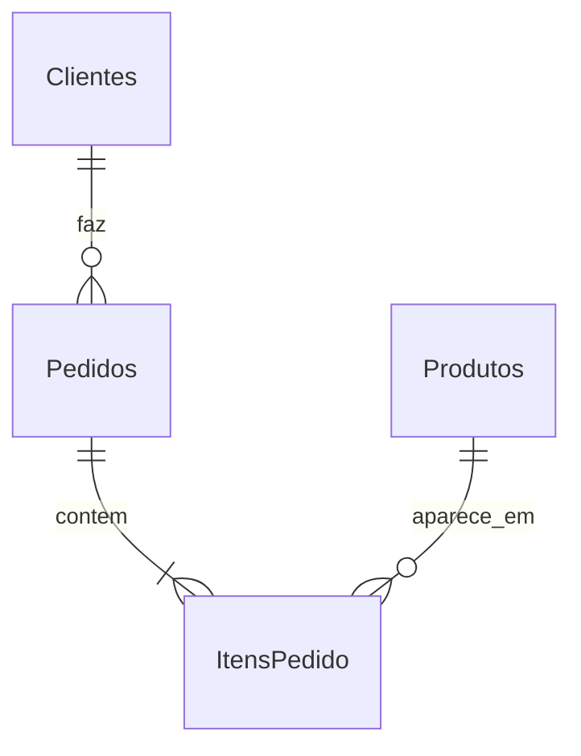

# Especificação: Gestão de Pedidos (B-MO)

Versão 1.1 · 13/11/2026 · status: revisada (ver seção 10)

Este documento descreve **o que** o B-MO deve fazer e **como saberemos que está pronto**. O **como implementar** fica no `docs/plan.md`. Se este documento e o código discordarem, um dos dois está errado, e a correção começa aqui.

---

## 1. Objetivo

O B-MO registra e consulta pedidos de clientes. Um atendente escolhe o cliente, monta o pedido com produtos do catálogo, e o sistema só aceita o pedido se houver estoque para tudo. Depois disso, qualquer pessoa consegue encontrar pedidos pelo nome do cliente, pelo número do pedido ou por período, e descobrir quais clientes mais compraram num intervalo de tempo.

O foco não é a complexidade das regras, e sim entregar poucas regras muito bem feitas: validadas, testadas e fáceis de entender.

---

## 2. Conceitos

Antes das regras, o vocabulário. Os mesmos nomes aparecem no banco, no código e na tela.

| Termo | Significado |
|---|---|
| **Cliente** | Quem faz pedidos. É identificado pelo seu número (`Id`). Dois clientes podem ter o mesmo nome; o e-mail os diferencia. |
| **Produto** | Item do catálogo, com preço atual e quantidade em estoque. |
| **Pedido** | Uma compra feita por um cliente, numa data, com um ou mais itens. |
| **Item do pedido** | Um produto dentro de um pedido: qual produto, quantas unidades e o preço unitário cobrado. |
| **Valor total** | Soma de `quantidade × preço unitário` de todos os itens do pedido. Não é gravado: é sempre calculado a partir dos itens. |
| **Horário de referência** | O horário de São Paulo (`America/Sao_Paulo`). É nele que "um dia" começa e termina para o negócio. |
| **Período** | Intervalo de dias, no horário de referência, com data inicial e data final incluídas. |

---

## 3. Escopo

**Dentro do escopo**

- Criar um pedido com seus itens.
- Listar pedidos em páginas, com busca por texto (nome ou e-mail do cliente, número do pedido), filtro por cliente e filtro por período.
- Consultar um pedido pelo número.
- Relatório dos clientes que mais compraram num período (5 por padrão, até 20).
- Listas de clientes e produtos, para alimentar a tela de criação.

**Fora do escopo**

- Login, usuários e permissões.
- Cadastro, edição e exclusão de clientes e produtos (eles vêm da carga inicial do banco).
- Editar, cancelar ou excluir pedidos.
- Status, pagamento e entrega de pedidos.

---

## 4. Modelo de dados



| Tabela | Coluna | Tipo | Regras |
|---|---|---|---|
| **Clientes** | Id | int | chave primária, gerado pelo banco |
| | Nome | nvarchar(150) | obrigatório, **pode repetir** |
| | Email | nvarchar(200) | obrigatório, único |
| | DataCadastro | datetime2 | obrigatório, padrão: agora (UTC) |
| **Produtos** | Id | int | chave primária, gerado pelo banco |
| | Nome | nvarchar(150) | obrigatório |
| | Preco | decimal(18,2) | obrigatório, maior que zero |
| | Estoque | int | obrigatório, nunca negativo |
| **Pedidos** | Id | int | chave primária, gerado pelo banco |
| | ClienteId | int | obrigatório, referencia `Clientes` |
| | DataPedido | datetime2 | obrigatório, definida pelo servidor (UTC) |
| **ItensPedido** | PedidoId | int | referencia `Pedidos`; parte da chave primária |
| | ProdutoId | int | referencia `Produtos`; parte da chave primária |
| | Quantidade | int | obrigatório, maior que zero |
| | PrecoUnitario | decimal(18,2) | obrigatório, copiado do produto na criação |

Quatro escolhas que merecem explicação:

- **A chave de `ItensPedido` é o par (PedidoId, ProdutoId).** Isso faz o próprio banco impedir o mesmo produto duas vezes no pedido (regra RN-04) e guarda os itens de um pedido fisicamente juntos, o que acelera as consultas que somam itens por pedido.
- **O preço é copiado para o item.** O preço do produto pode mudar amanhã; o que o cliente pagou, não (regra RN-08).
- **O valor total não é gravado em `Pedidos`.** Um número calculado e guardado em dois lugares pode divergir. Calculando sempre a partir dos itens, existe uma única fonte da verdade.
- **As datas são gravadas em UTC, e o fuso só entra na borda.** O banco guarda o instante exato, sem ambiguidade. A conversão para o horário de São Paulo acontece apenas ao interpretar filtros e ao exibir datas (regras RN-12 a RN-14).

Os índices e o motivo de cada um estão no `docs/plan.md`.

---

## 5. Regras de negócio

### 5.1 Criação de pedido

| Código | Regra |
|---|---|
| **RN-01** | O cliente informado precisa existir. |
| **RN-02** | O pedido precisa ter pelo menos um item. |
| **RN-03** | A quantidade de cada item é um número inteiro maior que zero. |
| **RN-04** | Um produto aparece no máximo uma vez por pedido. Para pedir mais unidades, aumenta-se a quantidade da linha. |
| **RN-05** | Todo produto do pedido precisa existir. |
| **RN-06** | Cada item precisa ter estoque suficiente. Ao criar o pedido, o estoque de cada produto diminui na quantidade pedida. |
| **RN-07** | **Tudo ou nada.** Se qualquer item falhar, nada é gravado e nenhum estoque muda. |
| **RN-08** | O preço unitário de cada item é o preço do produto no momento da criação. Quem chama a API não informa preço. Mudanças futuras de preço não alteram pedidos já feitos. |
| **RN-09** | A data do pedido é definida pelo servidor no momento da criação e gravada em UTC. |
| **RN-10** | Pedidos feitos ao mesmo tempo nunca deixam o estoque negativo. Se dois pedidos disputam a última unidade, um é aceito e o outro é recusado por estoque insuficiente. |
| **RN-11** | Se o cliente não existe (RN-01) ou o pedido não tem itens (RN-02), a resposta traz só esse problema. Caso contrário, **todos** os problemas dos itens voltam juntos, um por item, para que a tela marque cada linha de uma vez. |

Por que RN-04 importa: sem ela, duas linhas de 3 unidades de um produto com estoque 5 passariam numa verificação feita linha a linha, e o estoque terminaria em -1.

### 5.2 Datas e fuso horário

| Código | Regra |
|---|---|
| **RN-12** | O negócio opera no horário de São Paulo. Datas são **gravadas** em UTC, **interpretadas** (nos filtros) e **exibidas** (na tela) no horário de São Paulo, independentemente do fuso do servidor ou do navegador de quem acessa. |
| **RN-13** | No filtro de período, as duas datas são incluídas e valem o dia inteiro no horário de São Paulo. Com data final 31/12/2026, um pedido feito às 23:59:59 de 31/12 em São Paulo entra (no banco, ele está gravado como 01/01/2027 02:59:59 UTC); um pedido às 00:00:00 de 01/01/2027 em São Paulo, não. |
| **RN-14** | A data inicial não pode ser posterior à data final. |

Por que RN-12 existe: um pedido feito às 22h de 31/12 em São Paulo já é 01/01 em UTC. Sem a conversão, ele sairia do relatório do ano em que o cliente de fato comprou. A conversão usa a regra oficial do fuso (`America/Sao_Paulo`), não um "-3 horas" fixo, para continuar correta se o horário de verão voltar.

### 5.3 Consultas

| Código | Regra |
|---|---|
| **RN-15** | **Busca por texto.** O usuário encontra pedidos digitando o que vê na tela: um trecho do nome ou do e-mail do cliente. A comparação ignora maiúsculas, minúsculas e acentos ("joao" encontra "João"). Se o texto for só um número, a busca também traz o pedido com esse número. |
| **RN-16** | **Filtro por cliente.** Quando a tela já sabe qual cliente quer (por exemplo, ao clicar no nome dele numa linha da tabela), filtra pelo número do cliente. Isso separa clientes com o mesmo nome, o que a busca por texto não consegue. |
| **RN-17** | Os filtros se combinam: um pedido só aparece se atender a todos os filtros informados. |
| **RN-18** | A listagem vem do pedido mais recente para o mais antigo. Em caso de empate na data, o número do pedido maior vem primeiro. Esse desempate garante que a paginação nunca repita nem pule pedidos. |
| **RN-19** | Paginação: página padrão 1, tamanho padrão 20, tamanho máximo 100. |
| **RN-20** | O relatório de top clientes agrupa pelo **cliente** (seu `Id`, nunca pelo nome), soma o valor dos itens dos pedidos do período, ordena do maior para o menor valor e desempata pelo menor `Id`. Devolve 5 clientes por padrão; quem chama pode pedir de 1 a 20. Clientes sem pedidos no período não aparecem. |

---

## 6. API

### 6.1 Convenções

- Corpo em JSON com nomes em `camelCase`.
- Datas com hora saem em ISO 8601 UTC (`2026-11-13T13:05:00Z`). Quem exibe converte para o horário de São Paulo (RN-12).
- Filtros de data usam só o dia (`2026-11-13`) e são interpretados no horário de São Paulo (RN-13).
- Valores em dinheiro com duas casas decimais.
- Erros seguem o formato **ProblemDetails** (RFC 9457).

O status do erro diz que tipo de problema aconteceu:

| Status | Significado | Exemplo |
|---|---|---|
| **400** | Não foi possível ler a requisição, ou um parâmetro está fora do permitido. | JSON malformado, campo obrigatório ausente, data inicial depois da final, `limite=50` |
| **404** | O recurso pedido no endereço não existe. | `GET /pedidos/999999` |
| **422** | A requisição foi entendida, mas viola uma regra de negócio. | Cliente inexistente, estoque insuficiente |
| **500** | Erro inesperado no servidor. A resposta é genérica, com `traceId` para rastrear no log, sem detalhes internos. | Banco fora do ar |

O 400 usa o formato padrão de validação do ASP.NET Core (`errors` por campo). O 422 usa o formato abaixo, com um código estável que o front e os testes podem usar sem depender do texto da mensagem:

```json
{
  "title": "O pedido não pôde ser criado.",
  "status": 422,
  "codigo": "PEDIDO_INVALIDO",
  "erros": [
    {
      "codigo": "ESTOQUE_INSUFICIENTE",
      "mensagem": "Estoque insuficiente para Kit coffee break: solicitado 8, disponível 5.",
      "produtoId": 3,
      "solicitado": 8,
      "disponivel": 5
    }
  ]
}
```

### 6.2 `POST /pedidos`: criar pedido

**Requisição**

```json
{
  "clienteId": 12,
  "itens": [
    { "produtoId": 3, "quantidade": 2 },
    { "produtoId": 7, "quantidade": 1 }
  ]
}
```

**Resposta de sucesso:** `201 Created`, com o cabeçalho `Location: /pedidos/{id}`

```json
{
  "id": 1234,
  "clienteId": 12,
  "clienteNome": "Produtora Aurora",
  "clienteEmail": "contato@produtoraaurora.com.br",
  "dataPedido": "2026-11-13T13:05:00Z",
  "valorTotal": 249.70,
  "itens": [
    { "produtoId": 3, "produtoNome": "Kit coffee break", "quantidade": 2, "precoUnitario": 99.90, "subtotal": 199.80 },
    { "produtoId": 7, "produtoNome": "Crachá personalizado", "quantidade": 1, "precoUnitario": 49.90, "subtotal": 49.90 }
  ]
}
```

**Erros de regra (422)**

| Código | Regra | Dados extras |
|---|---|---|
| `CLIENTE_NAO_ENCONTRADO` | RN-01 | |
| `PEDIDO_SEM_ITENS` | RN-02 | |
| `QUANTIDADE_INVALIDA` | RN-03 | `produtoId` |
| `PRODUTO_DUPLICADO` | RN-04 | `produtoId` |
| `PRODUTO_NAO_ENCONTRADO` | RN-05 | `produtoId` |
| `ESTOQUE_INSUFICIENTE` | RN-06, RN-10 | `produtoId`, `solicitado`, `disponivel` |

### 6.3 `GET /pedidos`: listar pedidos

**Parâmetros (todos opcionais)**

| Parâmetro | Tipo | Padrão | Observação |
|---|---|---|---|
| `busca` | texto | | RN-15. Espaços nas pontas são ignorados; vazio equivale a não filtrar. |
| `clienteId` | int | | RN-16. Usado pela navegação da tela, não digitado pelo usuário. |
| `dataInicio` | data | | RN-13, RN-14 |
| `dataFim` | data | | RN-13, RN-14 |
| `pagina` | int | 1 | mínimo 1 |
| `tamanhoPagina` | int | 20 | de 1 a 100 |

Exemplos:

- O usuário digitou "aurora" e escolheu o ano de 2026: `GET /pedidos?busca=aurora&dataInicio=2026-01-01&dataFim=2026-12-31`
- O usuário clicou no nome de um cliente na tabela: `GET /pedidos?clienteId=7`

**Resposta:** `200 OK`

```json
{
  "itens": [
    {
      "id": 1234,
      "dataPedido": "2026-11-13T13:05:00Z",
      "clienteId": 7,
      "clienteNome": "Produtora Aurora",
      "clienteEmail": "contato@produtoraaurora.com.br",
      "quantidadeItens": 2,
      "valorTotal": 249.70
    }
  ],
  "pagina": 1,
  "tamanhoPagina": 20,
  "totalItens": 153,
  "totalPaginas": 8
}
```

`quantidadeItens` é o número de linhas do pedido (produtos diferentes), não a soma das unidades.

Uma busca ou um `clienteId` sem correspondência devolve uma lista vazia, não um erro: filtrar é perguntar "quais pedidos atendem a isto?", e "nenhum" é uma resposta válida.

### 6.4 `GET /pedidos/{id}`: consultar um pedido

`200 OK` com o mesmo formato da resposta de criação, ou `404 Not Found`.

### 6.5 `GET /relatorios/top-clientes`: maiores compradores do período

**Parâmetros**

| Parâmetro | Tipo | Padrão | Observação |
|---|---|---|---|
| `dataInicio` | data | obrigatório | RN-13, RN-14 |
| `dataFim` | data | obrigatório | RN-13, RN-14 |
| `limite` | int | 5 | de 1 a 20 (RN-20) |

Exemplo: `GET /relatorios/top-clientes?dataInicio=2026-01-01&dataFim=2026-12-31&limite=10`

**Resposta:** `200 OK`

```json
[
  { "posicao": 1, "clienteId": 7, "nome": "Produtora Aurora", "email": "contato@produtoraaurora.com.br", "totalPedidos": 12, "valorTotal": 15320.50 },
  { "posicao": 2, "clienteId": 31, "nome": "Eventos Lume", "email": "financeiro@eventoslume.com.br", "totalPedidos": 9, "valorTotal": 11870.00 }
]
```

O e-mail vem junto para que dois clientes com o mesmo nome possam ser diferenciados no relatório. Sem pedidos no período, a resposta é uma lista vazia.

### 6.6 Endpoints de apoio

| Endpoint | Para que serve | Resposta |
|---|---|---|
| `GET /clientes?busca=` | Preencher o seletor de cliente do novo pedido. Busca por trecho do nome ou do e-mail, com as mesmas regras de RN-15, e devolve até 50 clientes em ordem alfabética. | `[{ "id", "nome", "email" }]` |
| `GET /produtos` | Preencher o seletor de produto, mostrando preço e estoque. | `[{ "id", "nome", "preco", "estoque" }]` |
| `GET /health` | Dizer se a API está no ar e falando com o banco. Usado pelo Docker e pelo CI. | `200` ou `503` |

---

## 7. Telas

Todas as datas aparecem no horário de São Paulo (RN-12), mesmo que o computador de quem acessa esteja em outro fuso.

### 7.1 Lista de pedidos

É a tela inicial. Mostra uma tabela com número, data, cliente (nome e, logo abaixo, o e-mail em destaque menor), quantidade de itens e valor total em reais.

- **Busca:** um único campo de texto, "Buscar por cliente, e-mail ou nº do pedido". A busca dispara enquanto o usuário digita, com uma pequena espera para não chamar a API a cada tecla.
- **Período:** data inicial e data final.
- **Navegação por cliente:** clicar no nome de um cliente na tabela filtra os pedidos daquele cliente (RN-16). O filtro aparece como uma etiqueta removível ("Cliente: Produtora Aurora ×") acima da tabela.
- **Limpar:** um botão remove todos os filtros.
- **Filtros na URL:** busca, período, cliente e página ficam na URL. Recarregar a página ou compartilhar o link mantém a mesma consulta.
- **Paginação:** anterior e próxima, com a indicação "página X de Y".
- **Estados:** enquanto carrega, mostra um esqueleto da tabela; sem resultados, mostra uma mensagem dizendo que não há pedidos para os filtros escolhidos; se a API falhar, mostra o erro e um botão para tentar de novo.
- Um botão **Novo pedido** abre a tela de criação.

### 7.2 Novo pedido (modal)

- O usuário escolhe o cliente digitando parte do nome ou do e-mail; as sugestões mostram os dois, para não confundir homônimos. Por trás, o pedido é enviado com o número do cliente escolhido.
- O usuário adiciona linhas de item. Cada linha tem produto (com preço e estoque visíveis), quantidade e subtotal. O total do pedido aparece no rodapé.
- A tela já evita os erros óbvios antes de enviar: exige pelo menos um item, quantidade mínima de 1, quantidade até o estoque exibido, e desativa nas outras linhas um produto já escolhido.
- Mesmo assim, quem decide é o servidor. Se ele recusar, cada erro aparece **na linha do produto correspondente** (por exemplo, o estoque disponível atualizado, caso outra pessoa tenha comprado nesse meio-tempo).
- Se a falha não for de regra (servidor fora do ar ou erro inesperado), o modal continua aberto com os dados preenchidos e mostra um aviso para tentar de novo.
- Ao salvar com sucesso, o modal fecha, aparece uma confirmação, e a lista se atualiza com o novo pedido no topo, sem recarregar a página.

---

## 8. Critérios de aceite

Cada critério diz em qual nível de teste ele é verificado: **U** (unitário), **I** (integração, contra um SQL Server real) e **E2E** (Playwright, pelo navegador).

### 8.1 Criar pedido

| ID | Cenário | Resultado esperado | Teste |
|---|---|---|---|
| CA-01 | Cliente existe; produto com estoque 10; pedido de 3 unidades. | `201`, cabeçalho `Location`, valor total igual a 3 × preço, estoque passa a 7. | U, I, E2E |
| CA-02 | Cliente não existe. | `422 CLIENTE_NAO_ENCONTRADO`; nada gravado. | U, I |
| CA-03 | Lista de itens vazia. | `422 PEDIDO_SEM_ITENS`. | U |
| CA-04 | Item com quantidade 0 ou negativa. | `422 QUANTIDADE_INVALIDA` naquele item. | U |
| CA-05 | Mesmo produto em duas linhas, mesmo que cada linha caiba no estoque sozinha. | `422 PRODUTO_DUPLICADO`. | U |
| CA-06 | Produto não existe. | `422 PRODUTO_NAO_ENCONTRADO` naquele item. | U |
| CA-07 | Quantidade maior que o estoque. | `422 ESTOQUE_INSUFICIENTE` com `solicitado` e `disponivel`. | U, I, E2E |
| CA-08 | Quantidade exatamente igual ao estoque. | Aceito; estoque passa a 0. | U, I |
| CA-09 | Dois itens: o primeiro tem estoque, o segundo não. | `422`, e o estoque do **primeiro** produto não mudou. | I |
| CA-10 | O preço do produto muda depois do pedido criado. | O pedido continua com o preço antigo. | I |
| CA-11 | Produto com estoque 1; duas requisições enviadas ao mesmo tempo. | Exatamente um `201` e um `422`; estoque final 0. | I |
| CA-12 | Pedido com dois itens inválidos por motivos diferentes. | Um único `422` listando os dois problemas. | U |
| CA-13 | JSON malformado ou `clienteId` ausente. | `400`. | I |

### 8.2 Datas e fuso horário

| ID | Cenário | Resultado esperado | Teste |
|---|---|---|---|
| CA-14 | Filtro até 31/12/2026, com pedidos gravados em `2027-01-01T02:59:59Z` (23:59:59 de 31/12 em São Paulo) e em `2027-01-01T03:00:00Z` (00:00:00 de 01/01 em São Paulo). | O primeiro aparece; o segundo, não. | U, I |
| CA-15 | Filtro a partir de 01/01/2026, com um pedido gravado em `2026-01-01T02:00:00Z` (23h de 31/12/2025 em São Paulo). | O pedido não aparece. | I |
| CA-16 | Data inicial depois da final. | `400`. | U, I |
| CA-17 | Navegador configurado em outro fuso (por exemplo, UTC) abre a lista. | As datas aparecem no horário de São Paulo. | E2E |

### 8.3 Listar e consultar pedidos

| ID | Cenário | Resultado esperado | Teste |
|---|---|---|---|
| CA-18 | Sem filtros. | Página 1 com até 20 pedidos, do mais recente para o mais antigo. | I |
| CA-19 | Busca "joao" com um cliente chamado "João Eventos". | Os pedidos desse cliente aparecem (sem diferenciar acento nem maiúscula). | I, E2E |
| CA-20 | Busca por um trecho do e-mail do cliente. | Os pedidos desse cliente aparecem. | I |
| CA-21 | Busca "1234", existindo o pedido 1234. | O pedido 1234 está no resultado. | I |
| CA-22 | Dois clientes com o mesmo nome; busca por esse nome. | Aparecem os pedidos dos dois, cada linha com o e-mail do seu cliente. | I |
| CA-23 | Filtro por `clienteId` de um dos homônimos. | Só os pedidos daquele cliente. | I |
| CA-24 | Busca por texto + período juntos. | Só pedidos que atendem aos dois. | I |
| CA-25 | Percorrer todas as páginas de um resultado. | `totalItens` e `totalPaginas` corretos; nenhum pedido repetido ou ausente entre páginas. | I |
| CA-26 | `tamanhoPagina` igual a 101. | `400`. | U |
| CA-27 | `GET /pedidos/{id}` com número inexistente. | `404`. | I |

### 8.4 Relatório de top clientes

| ID | Cenário | Resultado esperado | Teste |
|---|---|---|---|
| CA-28 | Mais de 5 clientes com pedidos no período, sem informar `limite`. | Exatamente 5, do maior para o menor valor. | I |
| CA-29 | `limite=20` com 25 clientes no período. | Exatamente 20. | I |
| CA-30 | `limite=0` ou `limite=21`. | `400`. | U, I |
| CA-31 | Dois clientes diferentes com o mesmo nome. | Aparecem separados, cada um com seu próprio total e e-mail. | I |
| CA-32 | Pedidos fora do período, inclusive nas bordas do fuso (CA-14 e CA-15). | Não entram na soma. | I |
| CA-33 | Dois clientes com o mesmo valor total. | O de menor `Id` vem primeiro. | I |
| CA-34 | Sem `dataInicio` ou `dataFim`. | `400`. | I |

### 8.5 Telas

| ID | Cenário | Resultado esperado | Teste |
|---|---|---|---|
| CA-35 | Criar um pedido pelo modal, escolhendo o cliente pelo nome. | O modal fecha, aparece a confirmação e o pedido está no topo da lista, sem recarregar a página. | E2E |
| CA-36 | Clicar no nome de um cliente numa linha da tabela. | A lista mostra só os pedidos dele, com a etiqueta do cliente acima da tabela; remover a etiqueta volta à lista completa. | E2E |
| CA-37 | Aplicar busca e período e recarregar a página. | Os filtros continuam aplicados (estão na URL). | E2E |
| CA-38 | Tentar salvar com quantidade acima do estoque real. | O erro aparece na linha do produto, com o estoque disponível. | E2E |

### 8.6 Ambiente

| ID | Cenário | Resultado esperado | Teste |
|---|---|---|---|
| CA-39 | Clonar o repositório numa pasta nova e rodar `docker compose up`. | Banco criado e com dados de exemplo, API e front no ar, sem nenhum passo manual. | Manual e CI |

### 8.7 Erros inesperados

| ID | Cenário | Resultado esperado | Teste |
|---|---|---|---|
| CA-40 | Falha inesperada no servidor durante uma requisição (por exemplo, banco indisponível). | `500` em ProblemDetails com `traceId`; a resposta não traz stack trace, mensagem da exceção nem nomes internos; o mesmo `traceId` aparece no log. | I |
| CA-41 | Salvar o novo pedido com a API fora do ar ou respondendo `500`. | O modal continua aberto, com cliente e itens preenchidos, e mostra o aviso para tentar de novo; com a API de volta, tentar de novo cria o pedido sem precisar remontá-lo. | E2E |

---

## 9. Restrições técnicas

- **Banco:** SQL Server. Scripts de criação e carga de dados em `database/`, executados automaticamente ao subir o ambiente.
- **Backend:** .NET 10 (LTS).
- **Frontend:** React com TypeScript e shadcn/ui.
- **Execução:** a aplicação inteira sobe com `docker compose up`.
- **Testes:** unitários e de integração no backend (integração contra um SQL Server real) e ponta a ponta com Playwright no frontend.
- **Legibilidade:**
  - Os nomes do domínio são em português e iguais no banco, no código e na tela.
  - Cada fluxo principal tem uma explicação em prosa em `docs/fluxos/`, escrita para quem nunca viu o projeto.

---

## 10. Decisões de revisão (v1.1)

A versão 1 deixou três pontos em aberto. Estas foram as respostas e o que cada uma mudou no documento.

| # | Pergunta | Decisão | O que mudou |
|---|---|---|---|
| 1 | Os filtros de data devem usar UTC ou o horário de São Paulo? | **Horário de São Paulo.** Um pedido feito na noite de 31/12 pertence ao ano em que o cliente comprou, não ao ano do UTC. | Nova seção 5.2 (RN-12 a RN-14); conceito de horário de referência; datas na tela em horário de São Paulo; critérios CA-14 a CA-17. |
| 2 | O relatório de top clientes deve ter tamanho fixo? | **5 por padrão, até 20.** Atende o enunciado e permite uma visão maior sem mudar o endpoint. | Parâmetro `limite` em 6.5; RN-20; critérios CA-28 a CA-30. |
| 3 | Como o usuário filtra pedidos por cliente? | **Pelo que ele vê na tela**: trecho do nome, do e-mail ou o número do pedido. O número do cliente fica para a navegação interna, como clicar no nome dele numa linha, porque é o único jeito de separar clientes com o mesmo nome. | Parâmetro `busca` em 6.3; RN-15 a RN-17; e-mail do cliente nas respostas e na tabela; busca por nome no seletor do novo pedido; critérios CA-19 a CA-24 e CA-36. |
